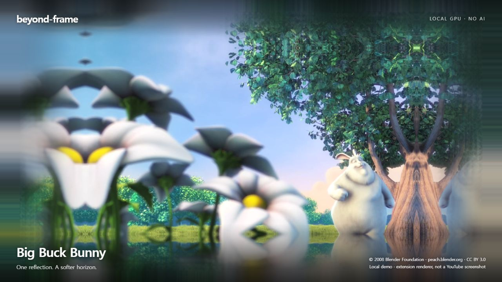
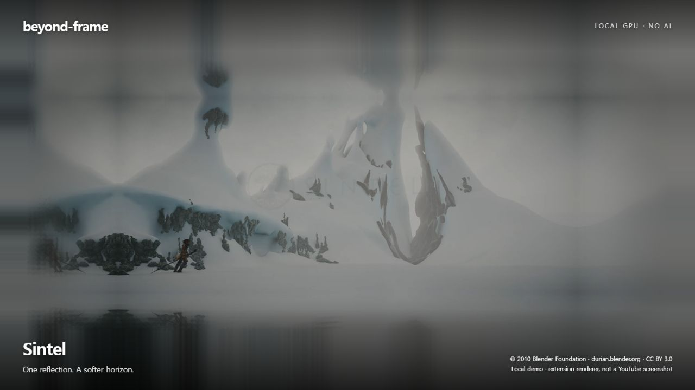
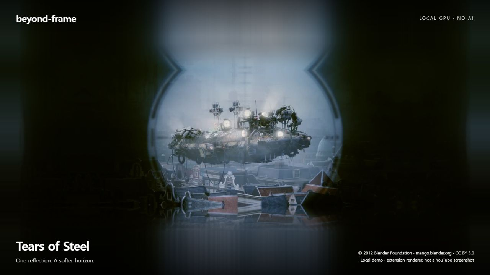

# Beyond Frame

Lightweight Chrome extension that extends YouTube video edges into a seamless, GPU-rendered background. No AI required.

GitHub repository name: `beyond-frame`.

## Preview

Real video frames rendered with the extension's unmodified GPU and page-integration code in a local demo player. These are **not captures of the YouTube website**. Background blur, brightness and quality use the extension's defaults. No AI-generated background or image retouching is used.

[Screenshot gallery](docs/gallery.html) · [Film credits and licenses](docs/SCREENSHOT-CREDITS.md)

현재 버전: 0.1.3. 스크롤바 폭과 화면 배율에 따라 영상 경계가 어긋나는 문제와 둥근 모서리의 흰 빈틈을 수정했습니다. 설정창·언어·반전 방식은 0.1.2와 같습니다.

유튜브 영상의 가장자리 색과 움직임을 브라우저 화면 바깥 여백까지 연결하는 크롬 확장프로그램입니다. AI 없이 WebGL로 처리합니다. 원본 영상은 그대로 두고 배경만 최대 30fps로 갱신합니다.

## 설치

1. ZIP 파일을 압축 해제합니다. 이미 폴더를 받았다면 그대로 사용합니다.
2. 크롬 주소창에 `chrome://extensions`를 입력합니다.
3. 오른쪽 위 **개발자 모드**를 켭니다.
4. **압축해제된 확장 프로그램을 로드합니다**를 누릅니다.
5. `manifest.json`이 바로 들어 있는 **beyond-frame** 폴더를 선택합니다. 기존 폴더 이름을 유지했다면 그 폴더를 선택합니다.
6. 이미 열려 있던 유튜브 탭을 새로고침하고 영상을 재생합니다.
7. 크롬의 퍼즐 모양 메뉴에서 **Beyond Frame**을 열면 설정을 바꿀 수 있습니다. 핀을 눌러 고정하면 편합니다.

기존 설치를 업데이트하려면 설치에 사용한 폴더의 파일을 새 버전으로 교체한 뒤 `chrome://extensions`에서 이 확장프로그램의 새로고침 버튼을 누르고 유튜브 탭도 새로고침하세요. 개발자 계정 등록 없이 로컬 설치로 사용할 수 있습니다.

## 사용

- 일반 화면에서는 브라우저 페이지의 영상 바깥 배경을 채웁니다. 유튜브 플레이어 전체화면에서도 작동하도록 구현했습니다. 브라우저 도구 모음이나 다른 프로그램의 화면까지 확장하지는 않습니다.
- 원본 영상·음성·자막·재생 버튼은 유튜브가 그대로 처리합니다. 검은 여백이 영상 파일에 이미 들어 있다면 그 검은 부분도 원본으로 취급합니다.
- **바깥쪽 흐림**: 경계에서 멀어질수록 적용되는 흐림 강도입니다.
- **바깥쪽 밝기**: 바깥 배경을 어둡게 조절합니다. 경계에서는 원본 밝기를 유지합니다.
- **처리 품질**: 기본은 균형 있게입니다. 팬 소음이나 버벅임이 있으면 가볍게로 낮추세요. 표시되는 수치는 배경의 내부 처리 폭입니다.
- 재생을 멈추거나 탭을 숨기면 반복 갱신을 멈춥니다. 기능을 끄면 GPU 자원을 해제합니다.

## 현재 구현의 범위

장면의 새로운 물체를 만드는 방식이 아니라, 가장자리 안쪽 20%의 영상 조각을 원래 표시 배율로 한 번 반사한 뒤, 그 바깥에는 반사 구간의 끝 색을 흐리게 연결하는 방식입니다. 사람이나 글자가 가장자리에 닿으면 반복되거나 늘어날 수 있습니다. 경계 근처는 흐림을 적게 적용하지만 배경의 내부 처리 해상도가 낮아 원본과 완전히 같은 선명도를 보장하지는 않습니다.

GPU 렌더링을 사용해도 영상 텍스처 전송과 브라우저 작업 비용은 남습니다. 30fps는 배경 갱신 목표 상한이며, 모든 기기에서의 실제 처리 속도나 전력 소모를 보장하지 않습니다. 4K 원본을 처리할 때는 비용이 늘 수 있습니다. 원본 영상 자체는 이 제한과 관계없이 재생됩니다.

브라우저 보안 제한이 있는 영상에서는 배경만 꺼지고 설정창에 이유가 표시됩니다. 영상의 보안 속성이나 재생 주소를 바꾸지 않습니다. 유튜브의 화면 구조가 바뀌면 대응 수정이 필요할 수 있습니다.

## 언어

크롬 UI 언어에 맞춰 설정창·상태·오류·개인정보 안내가 자동으로 표시됩니다. 한국어, 영어, 일본어, 중국어 간체, 스페인어, 프랑스어, 독일어, 포르투갈어(브라질), 인도네시아어, 베트남어를 지원하며 그 외 언어는 영어로 표시합니다.

## 개인정보와 권한

추가 권한은 설정 저장을 위한 `storage` 하나입니다. 콘텐츠 스크립트는 `www.youtube.com`과 `m.youtube.com`에만 들어갑니다. 영상이나 설정을 외부로 전송하는 코드, 서버 호출, AI 모델, 계정 로그인, 탭 캡처는 없습니다. 설정은 현재 크롬 프로필의 로컬 저장소에 보관됩니다.

영상 프레임과 화면 배치는 로컬에서 일시적으로 처리합니다. 자세한 내용은 설정창의 개인정보 안내 또는 [개인정보처리방침](privacy.html)을 참고하세요.

## 삭제

`chrome://extensions`에서 제거하고 유튜브 탭을 새로고침합니다.

## 개발

빌드나 패키지 설치 없이 폴더 자체로 로드할 수 있습니다. `core.js`는 설정·화면 배치·갱신 제한, `renderer.js`는 WebGL 처리, `content.js`는 영상과 페이지 연결을 맡습니다. `node --test tests/*.test.cjs`로 계산 로직을 검사할 수 있습니다. `tests/renderer.html`은 실제 WebGL 렌더러의 경계·반전 회귀 검사용입니다. `tests/layout.html`은 실제 콘텐츠 스크립트의 화면·스크롤바·배율별 좌표 검사입니다. 로컬 정적 서버에서 열고 Run edge tests를 누르세요. 검증 범위는 `VALIDATION.md`를 참고하세요.

MIT License.
